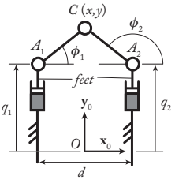
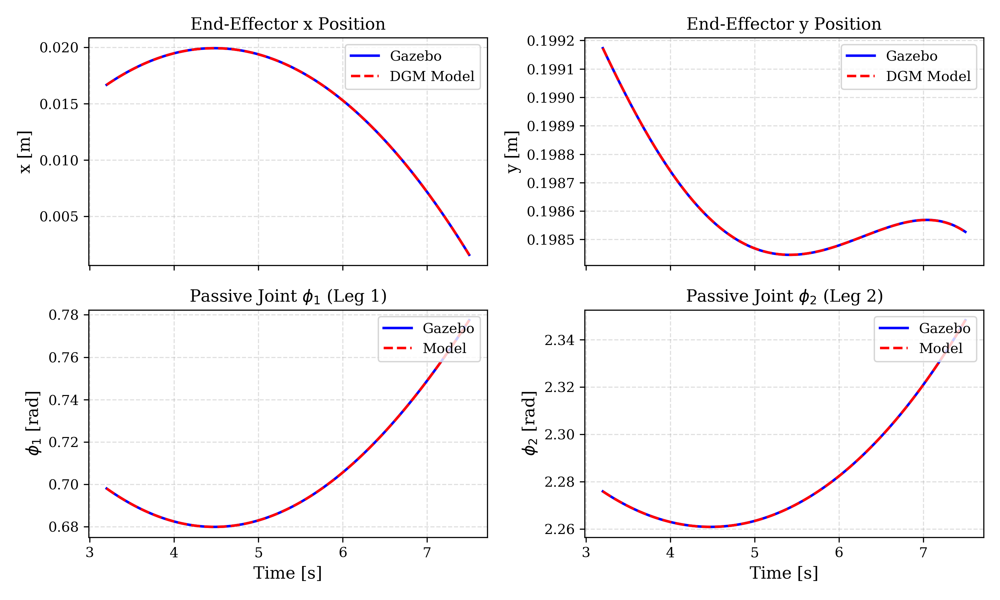
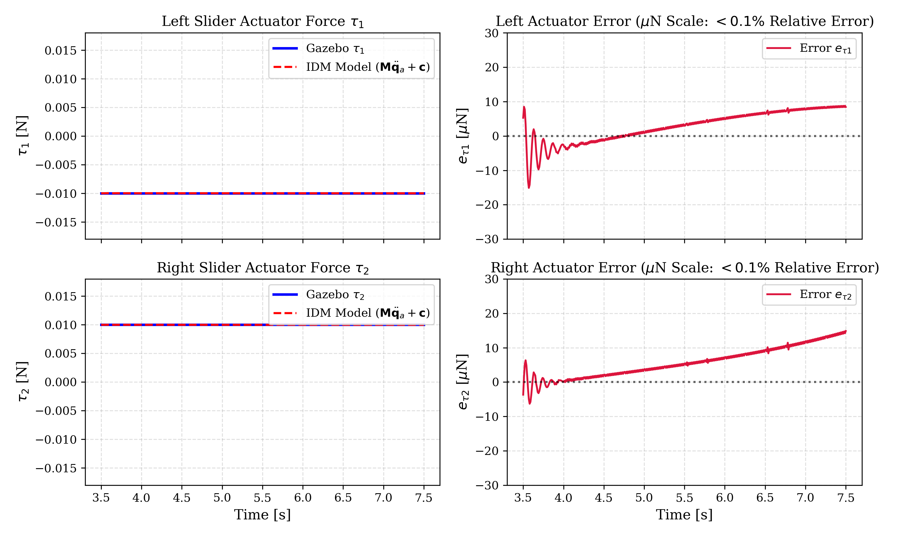
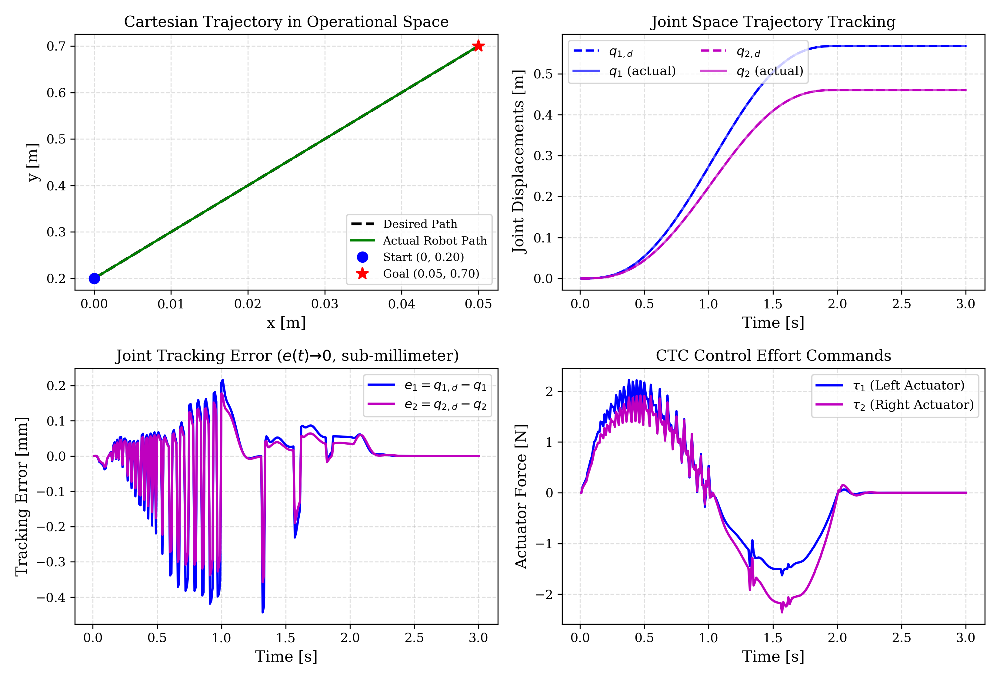
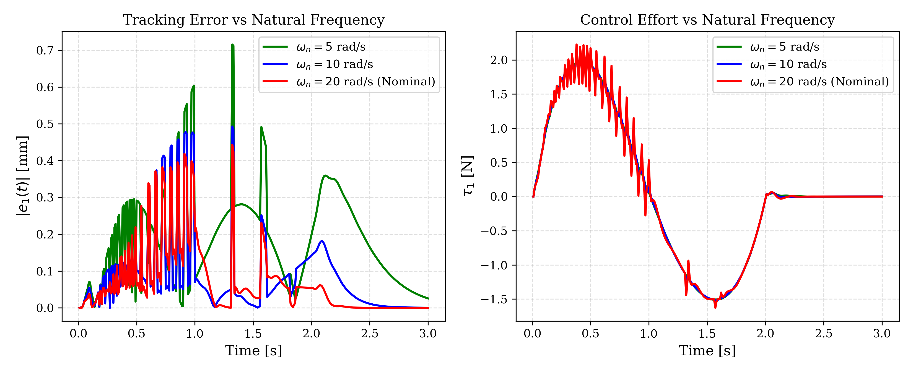
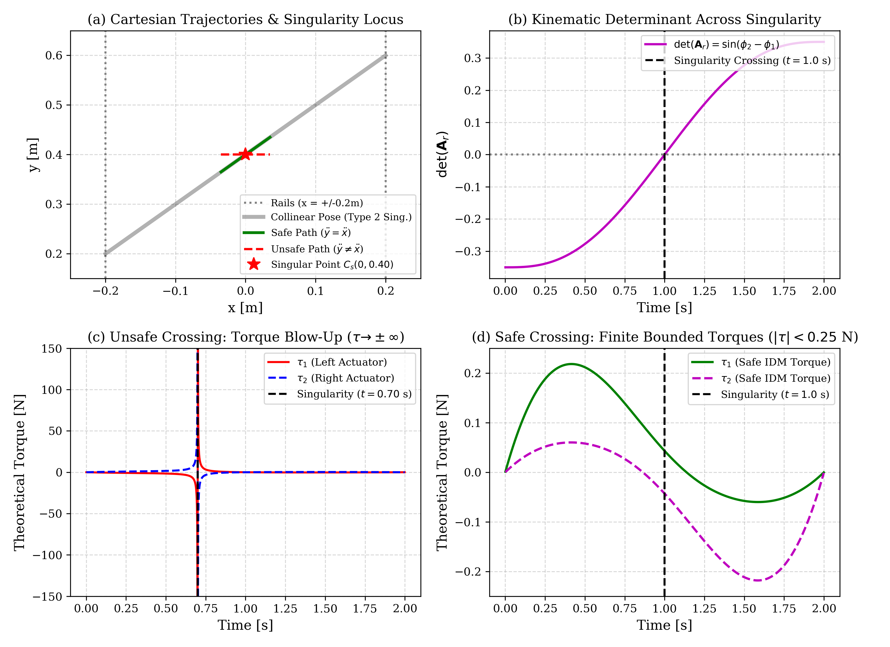

# 2-DOF Biglide Parallel Robot: Kinematics, Dynamics, and Computed Torque Control

A comprehensive robotics engineering framework for modeling, simulating, and controlling a planar 2-DOF **Biglide** parallel manipulator ($PuRRRPu$ architecture). This project includes analytical kinematic derivations, dynamic modeling via the Principle of Virtual Powers, validation against a physics engine via ROS 2 co-simulation, trajectory tracking with Computed Torque Control (CTC), and an in-depth Type-2 singularity study.

---

## Overview

Parallel kinematic manipulators (PKMs) offer high stiffness and high payload-to-weight ratios compared to serial arms, but exhibit coupled closed-loop kinematics and internal singularities. This project provides:

1. **Analytical Kinematic Pipeline**:
   - **Direct & Inverse Geometric Models (DGM / IGM)** accounting for assembly and working modes.
   - **First-Order Kinematics**: Explicit derivations of the constraint matrices $\mathbf{A}_r$, $\mathbf{B}$, and direct/inverse Jacobians.
   - **Second-Order Kinematics**: Convective acceleration formulation ($\mathbf{b}_p$, $\mathbf{a}_q$, $\mathbf{a}_t$).
2. **Inverse Dynamic Model (IDM)**:
   - Formulated using virtual tree decomposition and D'Alembert's Principle of Virtual Powers.
   - Explicit closed-form mass matrix $\mathbf{M}(\mathbf{q}_a)$ and Coriolis/centrifugal vector $\mathbf{c}(\mathbf{q}_a, \dot{\mathbf{q}}_a)$.
3. **Simulation & Validation**:
   - High-fidelity ROS 2 co-simulation in Gazebo at 100 Hz.
   - Quantitative evaluation across 3,000 co-simulation samples confirming sub-micrometer geometric agreement and sub-milli-Newton dynamic accuracy.
4. **Motion Control**:
   - Model-based Computed Torque Control (CTC) coupled with quintic polynomial trajectory planning.
   - Parametric gain study ($\omega_n$, $\zeta$) and robustness against initial state offsets.
5. **Type-2 Parallel Singularity Crossing**:
   - Theoretical investigation of dynamic consistency conditions ($\mathbf{t}_s^T \mathbf{w}_p = 0$).
   - Proof of bounded actuator forces ($|\tau| < 0.22\text{ N}$) along dynamically consistent paths versus torque blow-up along arbitrary paths.

---

## Mechanism Kinematics

The Biglide consists of two vertical actuated prismatic sliders ($A_1$ and $A_2$) spaced by distance $d = 0.4\text{ m}$, and two passive links of length $l = 0.2828\text{ m}$ meeting at end-effector $C(x, y)$.

<p align="center">
  
</p>

### Mathematical Summary

#### 1. First-Order Kinematic Constraints
```math
\mathbf{A}_r \dot{\mathbf{x}} + \mathbf{B} \dot{\mathbf{q}}_a = \mathbf{0}
```
where the parallel constraint matrices are defined as:
```math
\mathbf{A}_r = \begin{bmatrix} \cos\phi_1 & \sin\phi_1 \\ \cos\phi_2 & \sin\phi_2 \end{bmatrix}, \quad \mathbf{B} = -\begin{bmatrix} \sin\phi_1 & 0 \\ 0 & \sin\phi_2 \end{bmatrix}
```

#### 2. Inverse Jacobian
```math
\mathbf{J}^{-1} = -\mathbf{B}^{-1} \mathbf{A}_r = \begin{bmatrix} \cot\phi_1 & 1 \\ \cot\phi_2 & 1 \end{bmatrix}
```

#### 3. Second-Order Kinematics
```math
\mathbf{A}_r \ddot{\mathbf{x}} + \mathbf{B} \ddot{\mathbf{q}}_a + \mathbf{b}_p = \mathbf{0}, \quad \mathbf{b}_p = \begin{bmatrix} l \dot{\phi}_1^2 \\ l \dot{\phi}_2^2 \end{bmatrix}
```

#### 4. Equations of Motion (Inverse Dynamics)
```math
\boldsymbol{\tau} = \mathbf{M}(\mathbf{q}_a) \ddot{\mathbf{q}}_a + \mathbf{c}(\mathbf{q}_a, \dot{\mathbf{q}}_a)
```
```math
\mathbf{M}(\mathbf{q}_a) = m_f \mathbf{I}_{2\times 2} + m_p \mathbf{J}^T \mathbf{J}, \quad \mathbf{c}(\mathbf{q}_a, \dot{\mathbf{q}}_a) = m_p \mathbf{J}^T \mathbf{a}_t
```

---

## Experimental Validation & Results

### 1. Model Agreement with Gazebo Simulation

Open-loop oscillations in Gazebo demonstrate close agreement between the analytical equations and the physics engine.

| Model Variable | Evaluated Function | Mean Absolute Error | Status |
|---|---|---|---|
| Platform Position $x, y$ | `dgm` | $< 2.7 \times 10^{-6}\text{ m}$ | Passed |
| Passive Angles $\phi_1, \phi_2$ | `dgm_passive` | $< 7.9 \times 10^{-6}\text{ rad}$ | Passed |
| Platform Velocity $\dot{x}, \dot{y}$ | `dkm` | $< 4.2 \times 10^{-6}\text{ m/s}$ | Passed |
| Passive Rates $\dot{\phi}_1, \dot{\phi}_2$ | `dkm_passive` | $< 3.1 \times 10^{-5}\text{ rad/s}$ | Passed |
| Platform Acceleration $\ddot{x}, \ddot{y}$ | `dkm2` | $< 2.1 \times 10^{-4}\text{ m/s}^2$ | Passed |
| Inverse Coordinates $q_1, q_2$ | `igm` | $< 3.1 \times 10^{-6}\text{ m}$ | Passed |
| Inverse Velocities $\dot{q}_1, \dot{q}_2$ | `ikm` | $< 5.5 \times 10^{-6}\text{ m/s}$ | Passed |
| Actuator Forces $\tau_1, \tau_2$ | `dynamic_model` | $< 3.9 \times 10^{-4}\text{ N}$ | Passed |

<p align="center">
  
</p>

<p align="center">
  
</p>

---

### 2. Computed Torque Control (CTC)

A 5th-order polynomial trajectory tracks a path from $(0.0, 0.20)\text{ m}$ to $(0.05, 0.70)\text{ m}$ in $2.0\text{ s}$. The controller yields dynamic tracking errors below $0.44\text{ mm}$ and rapid recovery from initial position offsets within $0.3\text{ s}$.

<p align="center">
  
</p>

<p align="center">
  
</p>

---

### 3. Type-2 Singularity Crossing Analysis

When the robot links become collinear ($\phi_2 - \phi_1 = \pi$), $\det(\mathbf{A}_r) = 0$, leading to infinite actuator force requirements for arbitrary trajectories. By enforcing the dynamic consistency condition ($\ddot{y} = \ddot{x}$ at the singular crossing), the required theoretical actuator forces remain strictly finite ($|\tau| < 0.22\text{ N}$).

<p align="center">
  
</p>

---

## Repository Structure

```text
.
├── docs/
│   └── figures/                  # High-resolution validation plots and diagrams
├── scripts/
│   ├── biglide_models.py         # Complete kinematic and dynamic model functions
│   ├── control.py                # Computed Torque Controller with polynomial trajectory
│   ├── singularity_control.py    # Type-2 singularity analysis & crossing benchmark
│   ├── model_eval.py             # Numerical validation benchmark vs Gazebo ground truth
│   ├── model_test.py             # Real-time interactive model testing script
│   ├── inverse_model_test.py     # Verification script for inverse models
│   ├── five_bar_models.py        # Reference five-bar planar manipulator models
│   └── generate_report_figures.py# Publication plot generation script
├── src/                          # ROS 2 packages
│   ├── lab_amoro/                # Robot SDF models, Gazebo worlds, launch files, drivers
│   ├── lab_amoro_interfaces/     # Custom ROS 2 message definitions
│   └── labamoro_plugin/          # Gazebo C++ co-simulation plugin
├── .gitignore
└── README.md
```

---

## Getting Started

### Prerequisites

- **Python**: 3.8+ (with `numpy`, `matplotlib`)
- **ROS 2**: Humble / Iron / Rolling (optional, required for Gazebo co-simulation)
- **Gazebo**: Classic Gazebo 11

### 1. Offline Verification (No ROS required)

You can run the kinematic, dynamic, and singularity analyses directly with Python:

```bash
# Evaluate singularity crossing theory and theoretical torques
python3 scripts/singularity_control.py

# Generate publication-ready figures
python3 scripts/generate_report_figures.py
```

### 2. ROS 2 & Gazebo Co-Simulation

To run closed-loop simulation within a ROS 2 workspace:

```bash
# 1. Create a colcon workspace and clone the repository
mkdir -p ~/amoro_ws/src
cd ~/amoro_ws/src
git clone https://github.com/enghelnagar/ros2-biglide-parallel-robot.git .

# 2. Build the ROS 2 packages
cd ~/amoro_ws
colcon build --symlink-install
source install/setup.bash

# 3. Launch Gazebo with the Biglide mechanism
ros2 launch lab_amoro gazebo.launch.py

# 4. In a separate terminal, run the Computed Torque Controller
source ~/amoro_ws/install/setup.bash
python3 src/scripts/control.py  # or python3 scripts/control.py depending on workspace root

# 5. Run the automated model evaluation benchmark
python3 src/scripts/model_eval.py  # or python3 scripts/model_eval.py
```

---

## Author

- **Hussein Elnaggar**
  - LinkedIn: [@enghelnagar](https://www.linkedin.com/in/eng-h-elnaggar/)
  - Program: M2 EMARO+ (Advanced Robotics)
